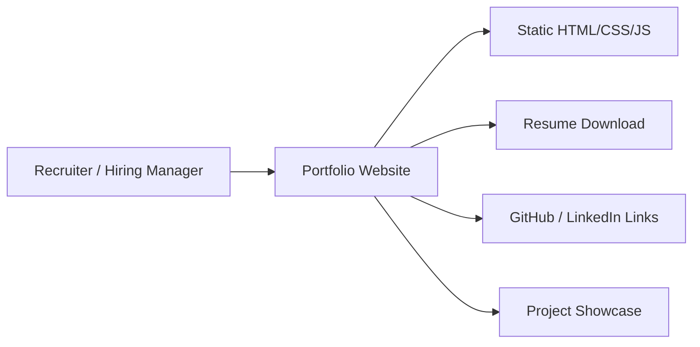
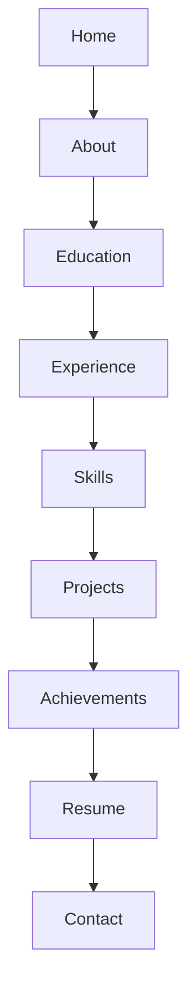

# Portfolio Website Architecture

## 1. Executive Summary

This document defines the architecture for a modern, responsive, recruiter-focused portfolio website for Wandile Nene, a Computer Science graduate and AI Engineer Intern seeking Software Development and Software Engineering opportunities.

The site will serve as a professional online resume, portfolio, and personal brand platform. It must present educational background, work experience, certifications, leadership experience, technical skills, and projects in a polished and easy-to-scan structure. The website will be optimized for recruiters, hiring managers, and technical interviewers who need a fast, credible overview of the candidate’s potential.

The architecture is intentionally designed to remain simple for deployment on GitHub Pages while remaining extensible for future growth into React, Next.js, Node.js, FastAPI, or ASP.NET-based services. The solution favors maintainability, modularity, accessibility, SEO, and performance over unnecessary complexity.

---

## 2. Goals

The primary goals of the portfolio are:

- Showcase technical capability and software engineering thinking.
- Demonstrate AI experience through practical and application-focused examples.
- Present projects and achievements in a polished and recruiter-friendly way.
- Increase the likelihood of interview invitations and employer engagement.
- Provide a strong online resume experience that is easy to navigate on all devices.
- Establish a scalable foundation for future enhancements such as dynamic data integration or CMS-like content management.

### Success Criteria

- Strong first impression within seconds of load.
- Clear presentation of education, experience, skills, and projects.
- Fast, frictionless mobile experience.
- Smooth navigation and clear calls to action.
- Professional visual branding aligned with AI and engineering values.

---

## 3. Functional Requirements

The website must include the following key sections:

1. Home page
2. About section
3. Education section
4. Experience timeline
5. Skills section
6. Certifications section
7. Projects section
8. Achievements section
9. Resume section
10. Contact section
11. Footer

### Functional Behavior

- Navigation should support smooth scrolling between sections.
- Each section should be accessible using semantic HTML landmarks.
- Projects should present a concise description, technologies used, and key features.
- A downloadable resume should be available from the site.
- Contact information should be clearly visible and easy to use.
- A professional visual hero section should introduce the portfolio owner.
- The site should support light and dark themes if design direction allows, but default behavior should remain clean and professional.

---

## 4. Non-functional Requirements

### Quality Attributes

| Attribute | Requirement |
|---|---|
| Responsive | Must work across mobile, tablet, desktop, and large screens. |
| Fast Loading | Lightweight assets and optimized structure should minimize load time. |
| SEO Optimized | Semantic markup, metadata, and structured content should help indexing. |
| Accessible | Keyboard navigation, contrast support, ARIA where needed, and semantic structure should support all users. |
| Maintainable | Modular structure and clear separation of concerns should reduce future maintenance cost. |
| Reusable | UI elements and content patterns should be reusable across sections. |
| Secure | Static site architecture minimizes attack surface and eliminates backend exposure where not needed. |
| Cross-browser Compatible | Core behavior should work across common modern browsers. |

---

## 5. Architecture Overview

### High-Level View

The portfolio is a static, content-driven frontend website with a simple document-oriented architecture. The implementation should remain lightweight, easy to host, and straightforward to maintain while also allowing future expansion.

### Architectural Style

The website fits a layered static frontend architecture:

- Presentation Layer: HTML, CSS, and JavaScript for rendering and interactivity.
- Content Layer: Structured data objects or sections for portfolio content.
- Interaction Layer: Smooth scrolling, animations, theme toggles, and UI behavior.
- Deployment Layer: GitHub Pages for static hosting.

### Architectural Principles

- Progressive enhancement over heavy dependencies.
- Content-first design.
- Semantic and accessible HTML.
- Separation of structure, style, and behavior.
- Extensibility for future backend or framework adoption.

### System Context Diagram



### Design Strategy

Because the site will be hosted on GitHub Pages, the initial architecture should avoid runtime backend requirements. Content can be stored as JavaScript object data or structured HTML files. When the portfolio grows, the structure can be migrated to a framework without rewriting the core information architecture.

---

## 6. Folder Structure

A recommended initial folder structure:

```text
/
├── index.html
├── assets/
│   ├── images/
│   ├── icons/
│   └── resume/
├── css/
│   ├── styles.css
│   └── themes.css
├── js/
│   ├── main.js
│   ├── data.js
│   └── animations.js
├── components/
│   ├── navbar.html
│   ├── hero.html
│   ├── projects.html
│   └── footer.html
├── data/
│   └── portfolio-data.js
├── docs/
│   └── architecture.md
├── architecture.md
└── README.md
```

### Folder Purpose

| Folder | Purpose |
|---|---|
| `/` | Root contains the main entry point and project-level documentation. |
| `assets/images/` | Stores profile images, project screenshots, and general visual assets. |
| `assets/icons/` | Stores SVG icons and social platform icons. |
| `assets/resume/` | Stores downloadable resume files in PDF or DOCX format. |
| `css/` | Holds all stylesheet logic, theme rules, and layout definitions. |
| `js/` | Contains JavaScript behavior logic, data definitions, and animation handling. |
| `components/` | Houses reusable UI partials or structured markup fragments for future templating. |       
| `data/` | Contains structured content data for portfolio sections. |
| `docs/` | Optional documentation area for architecture notes, implementation records, and design rationale. |
| `architecture.md` | Primary system architecture and implementation guide. |
| `README.md` | Project onboarding, hosting instructions, and developer overview. |

---

## 7. Component Breakdown

### Core UI Components

| Component | Purpose | Notes |
|---|---|---|
| Navbar | Sticky navigation for quick section access. | Should support mobile collapsible menu. |
| Hero Section | Introduces Wandile Nene with title, tagline, and CTA buttons. | Important for first impression and recruiter conversion. |
| About Section | Summarizes professional identity and target areas. | Should remain concise and credible. |
| Education Section | Displays BSc degree, institution, and graduation year. | Structured academic presentation. |
| Experience Timeline | Shows internship, tutoring, and bootcamp experience. | Visual clarity is essential. |
| Skills Section | Categorized skill display using chips or progress bars. | Use grouped skill sets for readability. |
| Certifications | Lists relevant certifications. | Display with subtle emphasis. |
| Projects | Cards for major projects with technologies and capabilities. | Strong evidence of hands-on capability. |
| Achievements | Highlights academic commendations and recognition. | Adds trust and credibility. |
| Resume Section | Contains a direct CTA to download or view resume. | Important conversion element. |
| Contact Section | Provides email, phone, GitHub, LinkedIn, and contact form options. | Simple and clear. |
| Footer | Stores small navigation and quick professional links. | Should remain uncluttered. |

### Interaction Components

- Smooth scroll navigation.
- Scroll reveal animations.
- Typing effect in the hero section.
- Animated counters or stats for projects, years of study, and practical exposure.
- Theme toggle where supported.
- Hover interactions for cards and buttons.

### Data Components

The following should ideally be stored in a structured and maintainable format:

- Personal profile details
- Experience timeline entries
- Skills grouped by category
- Project metadata
- Certifications and achievements
- Contact links

A `portfolio-data.js` file can provide a single source of truth for content.

---

## 8. Navigation Flow

The navigation should follow a linear, recruiter-friendly journey:

1. User lands on the homepage.
2. Hero section communicates identity and professional value quickly.
3. User scrolls to About, Education, Experience, and Skills.
4. User reviews projects and achievements.
5. User accesses resume download or contact section.
6. User clicks GitHub or LinkedIn for deeper verification.

### Navigation Behavior

- Sticky top navigation bar.
- Section anchors with smooth scrolling.
- Mobile menu that opens and closes cleanly.
- Active section emphasis can be added using JavaScript scroll tracking.

### Navigation Concept Diagram



---

## 9. User Journey

### Primary User Journey

A typical recruiter journey might look like this:

1. Recruiter visits the site from LinkedIn, email, or GitHub.
2. The hero section confirms the candidate’s professional identity immediately.
3. The recruiter scans the experience and education sections.
4. The recruiter reviews projects and technical stack.
5. The recruiter checks contact or resume links to learn more.
6. The recruiter reaches out for interview or collaboration.

### Journey Goals

- Provide immediate clarity of expertise.
- Reduce cognitive load and unnecessary scrolling.
- Support quick trust-building.
- Make contact or follow-up simple.

---

## 10. UI/UX Guidelines

### Recommended Styling Direction

- Modern professional layout.
- Glassmorphism accents where subtle and appropriate.
- Minimalist visual density.
- Clean card-based components.
- Strong, readable typography.
- Balanced white space.
- Animated interface elements that feel polished rather than distracting.

### UI Patterns

- Hero section with impactful headline and call-to-action.
- Timeline for experience and progression.
- Cards for projects, certifications, and skills.
- Animated statistics and metrics for visual engagement.
- Buttons that clearly highlight contact and resume access.

### Animation Recommendations

- Scroll reveal effects.
- Typing effect in the headline.
- Hover elevation effects on cards.
- Soft transitions on theme changes and menu interaction.

### Visual Content Strategy

- Use a professional portrait image if available.
- Use iconography for GitHub, LinkedIn, email, and resume.
- Use sparing visual noise, favoring clarity and brand trust.

---

## 11. Technology Decisions

### Frontend Stack

| Layer | Technology |
|---|---|
| Markup | HTML5 |
| Styling | CSS3 |
| Interaction | JavaScript (ES6) |
| Hosting | GitHub Pages |
| Version Control | Git and GitHub |

### Why These Technologies

- HTML5 provides semantic structure and long-term interoperability.
- CSS3 allows strong UI control with responsive layouts and modern effects.
- JavaScript enables smooth animation and lightweight dynamic behavior.
- GitHub Pages is ideal for a static portfolio site that needs low operational overhead.

### Extensibility Strategy

The architecture should remain compatible with future upgrade paths:

- Replace static rendering with React for component-driven UI.
- Adopt Next.js for improved SEO and content routing.
- Introduce Node.js or FastAPI services for dynamic backend features.
- Scale into ASP.NET for enterprise-oriented systems.

---

## 12. Security Considerations

Although the site is static and lightweight, security must still be considered.

### Security Measures

- Avoid exposing sensitive internal data or environment secrets.
- Use secure contact form handling if backend forms are later introduced.
- Sanitize any user-submitted content in future dynamic extensions.
- Prefer trusted CDNs and well-maintained third-party assets.
- Keep dependencies minimal and audit them as needed.

### Security Posture

The first iteration should be a static front-end architecture with low attack surface. This is an advantage for a portfolio site because the primary risks involve external asset trust, broken links, and content misuse rather than server compromise.

---

## 13. Performance Optimizations

The site must feel quick and polished.

### Optimization Recommendations

- Keep image sizes compressed and appropriately resized.
- Use modern image formats where supported.
- Avoid unnecessary animation complexity on mobile devices.
- Load fonts in a controlled and minimal way.
- Use CSS variables and organized selectors to avoid redundancy.
- Minify CSS and JS for production release.
- Preload key assets such as profile images or a resume file.

### Performance Targets

- Fast first load on mobile networks.
- Smooth scrolling and instant navigation interactions.
- Minimal layout shifts.
- Reliable cross-device consistency.

---

## 14. Accessibility

Accessibility is a core requirement and should not be considered optional.

### Accessibility Guidelines

- Use semantic headings and landmarks.
- Maintain contrast and readability for all text.
- Add descriptive `alt` text to images.
- Ensure all controls are keyboard accessible.
- Use focus indicators on buttons, links, links in navigation, and form elements.
- Guarantee that navigation and section content remain understandable with reduced motion settings.
- Ensure the site remains usable at mobile sizes without content loss.

### Accessibility Goals

- Inclusive experience for users with limited vision or motor constraints.
- Better SEO outcomes through semantic structure.
- Increased professionalism and marketability for the portfolio.

---

## 15. SEO Strategy

The portfolio site should be discoverable through search and social referral.

### SEO Recommendations

- Use a descriptive title and meta description.
- Include semantic section headings such as `About`, `Experience`, and `Projects`.
- Use meaningful anchor text and descriptive links.
- Provide structured content for skills, projects, and education.
- Include social profile links and a resume download link.
- Ensure metadata reflects the portfolio owner’s professional identity.

### Search Intent Alignment

The content and metadata should answer common recruiter queries such as:

- Who is Wandile Nene?
- What experience does he have?
- What technical skills does he bring?
- What projects or AI work has he completed?

---

## 16. Future Enhancements

This architecture should be flexible enough to support growth.

### Planned Enhancement Paths

- Migrate from static HTML sections to a React component-driven architecture.
- Add a CMS or structured content management layer.
- Add dynamic project filtering and sorting.
- Add blog or technical writing content to support thought leadership.
- Add multilingual support for broader audience reach.
- Introduce a small backend for contact form processing or analytics.
- Replace static resume hosting with a dynamic resume viewer.

### Strategic Upgrade Sequence

1. Static portfolio release.
2. Component modularization and data-driven content.
3. Framework migration for maintainability.
4. Optional backend integration for forms or real-time content.

---

## 17. Deployment Strategy

### Initial Deployment

The first production deployment should target GitHub Pages.

### Deployment Principles

- Keep the site static and lightweight.
- Use semantic and clean markup for compatibility.
- Maintain all content as structured, version-controlled files.
- Commit site updates frequently and review changes carefully before deploy.

### Future Deployment Paths

If the portfolio grows into a more interactive application, deployment can migrate to:

- Vercel or Netlify for frontend hosting.
- Azure App Service for server-backed deployments.
- Node.js / FastAPI / ASP.NET backend services for API-driven features.

---

## 18. Risks and Mitigations

| Risk | Impact | Mitigation |
|---|---|---|
| Site looks generic or too template-like | Weak professional impression | Use tailored content and a distinctive visual system. |
| Poor mobile usability | Lost recruiters and reduced engagement | Design mobile-first and test on multiple screen sizes. |
| Overuse of animations | Reduced performance and distraction | Keep transitions subtle and purposeful. |
| Weak content visibility | Recruiters may miss important details | Prioritize high-signal sections at the top. |
| Technical debt from poor structure | Harder future maintenance | Use modular file boundaries and consistent naming. |
| SEO limitations in static HTML | Reduced search discoverability | Add strong metadata, semantic structure, and descriptive text. |

---

## 19. Testing Strategy

### Testing Dimensions

- Functional testing for navigation, scrolling, and section visibility.
- Responsive testing across major screen sizes.
- Browser compatibility testing across Chrome, Edge, Firefox, and Safari.
- Accessibility testing using keyboard interaction and contrast review.
- Link validation for GitHub, LinkedIn, resume, and contact paths.
- Performance checks for loading time and layout stability.

### Recommended Testing Approach

- Use manual QA for visual and content quality.
- Validate HTML structure and semantics.
- Review interactive features in multiple browsers.
- Test resume download links and external navigation.

### Test Checklist

- Home page loads cleanly.
- Navbar opens and scrolls to each section.
- Resume download is available and correct.
- Project cards render consistently.
- Dark or light theme toggle works if implemented.
- Contact links are valid and accessible.

---

## 20. Maintenance Plan

The portfolio should remain easy to update over time.

### Maintenance Responsibilities

- Update experience, certifications, and achievements as new information becomes available.
- Refresh project details and technologies based on current work.
- Replace resume file when a new version is approved.
- Review external links periodically.
- Audit accessibility and mobile behavior after major updates.

### Maintenance Principles

- Keep content data separate from layout when possible.
- Use consistent naming conventions and section structure.
- Document visual and content decisions in the repository.
- Keep the site lightweight and easy to re-host.

### Recommended Maintenance Cadence

- Monthly content review for accuracy.
- Quarterly visual review for brand consistency.
- Annual architecture review for modernization opportunities.

---

## Suggested Color Palette

A professional AI-inspired palette should communicate trust, intelligence, and innovation.

| Role | Color | Suggested Use |
|---|---|---|
| Primary | `#0F172A` | Headings, strong text, nav accent |
| Secondary | `#1D4ED8` | Primary buttons, key active elements |
| Accent | `#14B8A6` | Highlights, badges, UI emphasis |
| Background | `#F8FAFC` | Main page background |
| Surface | `#FFFFFF` | Card surfaces and section containers |
| Text | `#0F172A` | Standard body copy |
| Muted Text | `#64748B` | Secondary descriptions |

### Theme Note

A dark-mode variant can be introduced later by mapping the same tokens to darker surface backgrounds while preserving the same information hierarchy.

---

## Typography Recommendations

Recommended Google Fonts:

- Heading Font: `Poppins`
- Body Font: `Inter`
- Accent/Display Font: `Space Grotesk` (optional for hero emphasis)

These fonts create a modern, professional, and highly readable visual identity.

---

## Implementation Summary

The proposed portfolio website is intentionally simple, high-trust, and strong in recruiter value. It should feel like a polished digital resume rather than a generic personal blog. The architecture emphasizes maintainability, strong semantics, performance, accessibility, and extensibility so that the site can evolve from a static GitHub Pages artifact into a more advanced engineering portfolio platform when needed.

The final implementation should therefore prioritize:

- strong first impact,
- clear evidence of engineering competence,
- clean and accessible design,
- minimal friction for recruiters,
- and a structured architecture that supports long-term growth.
